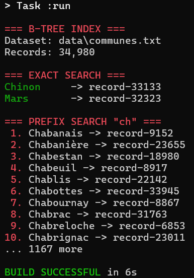
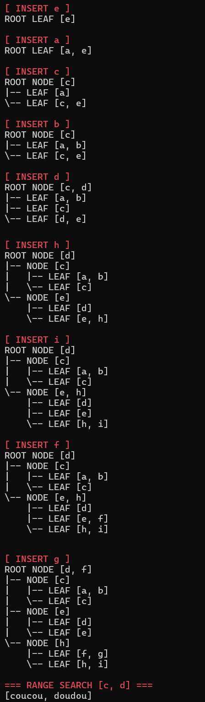

# B-Tree Indexing Engine in Java

[](https://github.com/ErkinTunc/B-Tree/actions/workflows/gradle.yml)

**An in-memory Java index for 34,980 French municipality entries — focused on search correctness, not just implementation.**

Supports **exact lookup**, **range queries with subtree pruning**, and **case- and accent-insensitive prefix search**. Developed for an Advanced Databases course and improved through regression tests and refactoring.

## See it in action

<p align="center">
  <a href="docs/imgs/demos/communes-demo.png">
    
  </a>
</p>

<p align="center"><em>Exact lookup and prefix search on 34,980 municipality records. Click to enlarge.</em></p>

```bash
./gradlew run --args="communes"
```

<details>
<summary><strong>See B-Tree insertion and node splitting</strong></summary>

<p align="center">
  <a href="docs/imgs/demos/tree-insertion.png">
    
  </a>
</p>

```bash
./gradlew run --args="simple"
```
</details>

## Engineering highlights

- **Fixed missing range results:** Updated `minKey`/`maxKey` metadata after insertion to prevent valid records from being incorrectly pruned.
- **Fixed duplicate-key handling:** Separated leaf-insertion and internal-node routing rules so an existing key is replaced correctly.
- **Prioritized correct prefix searches:** Normalized case and accents without unsafe pruning based on a different key ordering.

**Evidence:** [JUnit regression tests](src/test/java/arbreb/ArbreBRegressionTest.java) · [Design decisions](docs/design-decisions.md)

## Run and test

```bash
./gradlew test
./gradlew run --args="simple"
./gradlew run --args="communes"
```

On Windows PowerShell, replace `./gradlew` with `.\gradlew.bat`.

**Current scope:** Educational in-memory index with string keys and values. Benchmarks and disk persistence are **planned, not implemented**.

[Architecture](docs/architecture.md) · [Testing](docs/testing.md) · [Roadmap](docs/roadmap.md)

**Stack:** `Java` · `Gradle` · `JUnit 5` · `Git` · `GitHub Actions (CI)`

---

## B+ Tree Structure (Planned)

<p align="center">
  <a href="docs/imgs/B%2BTree_Lookup_and%20_Range_Scan_Diagram-2.png">
    
  </a>
</p>

<p align="center">
  <em>Conceptual illustration of B+ Tree structure, point lookup, and range scan.</em>
</p>